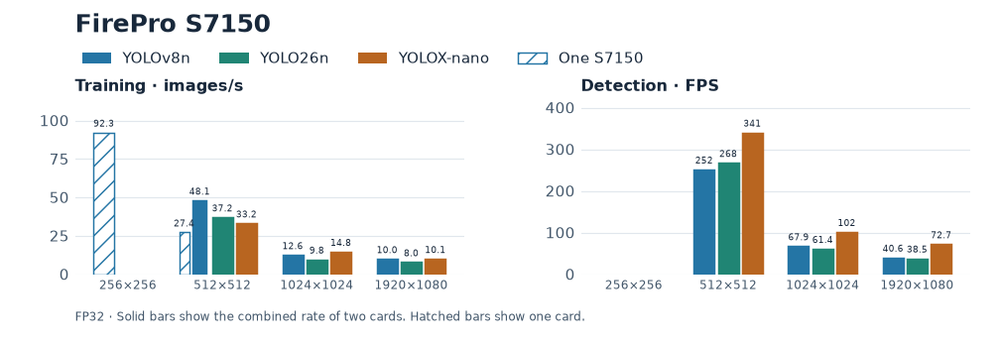
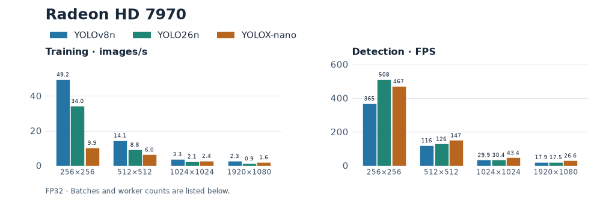
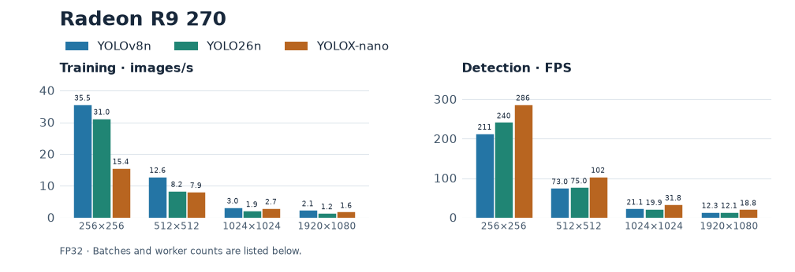
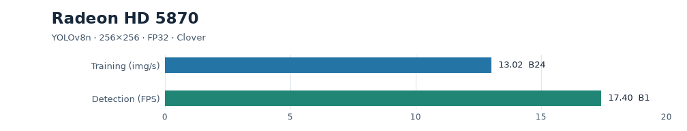
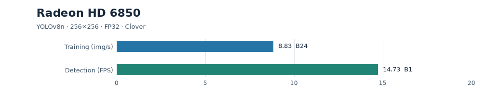
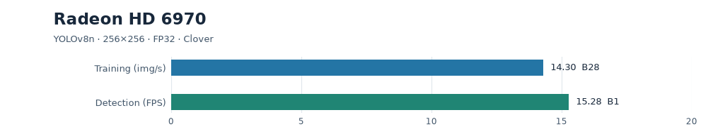

# Pytorch OpenCL backend based on dlprimitives

Radeon development fork: see the [verified five-card baseline](docs/RADEON_MINIMAL_BASELINE.md),
[local changes](LOCAL_CHANGES.md), and the
[experimental legacy Radeon build/profile guide](docs/r600-clover.md).
The upstream network/device results below are retained as upstream documentation;
they are not a validation matrix for this fork's new r600 paths.

## Giving old Radeon GPUs a second life

This project makes older AMD Radeon cards usable for modern PyTorch workloads through OpenCL. It builds on **DLPrimitives and pytorch_dlprim**, with fixes and optimizations across the Torch backend and Mesa’s Clover and Rusticl paths.

The goal is practical: let people experiment with machine learning using hardware they already own. A retired gaming card can become a training device, a wildlife detector, or a way to learn how neural networks work.

### Who it’s for

- **Students and curious builders** learning PyTorch without buying a new GPU.
- **People reusing old PCs**, particularly where modern hardware is expensive or difficult to obtain.
- **Hobbyists building vision projects** such as wildlife cameras, feeder monitors and small automation systems.
- **Open source developers** interested in improving support for overlooked hardware.

Support is currently demonstrated for specific detection workloads and configurations. This is an experimental backend, and broader model compatibility remains work in progress.

### What works today

FP32 YOLO training and detection work on the Radeon cards below. GCN uses RustiCL with radeonsi. Detection is timed from decoded frames through final detections. GCN training rates are from short fixture runs. HD inputs use 1920×1080 images padded to 1920×1088. Batches are per worker.

## Hardware Optimizations

### FirePro S7150

S7150 ×2 rates are combined across two 8 GB cards. B4 × 3 means three batch-4 workers per GPU.

| Model | Input | Training images/s (batch) | Detection FPS (batch) | Configuration |
| --- | --- | ---: | ---: | --- |
| YOLOv8n | 256×256 | 92.35 (B128) | — | S7150 ×1 |
| YOLOv8n | 512×512 | 27.38 (B40) | — | S7150 ×1 |
| YOLOv8n | 512×512 | 48.10 (B16) | 252.28 (B16) | S7150 ×2 |
| YOLOv8n | 1024×1024 | 12.60 (B8) | 67.92 (B12) | S7150 ×2 |
| YOLOv8n | 1920×1080 | 10.02 (B6) | 40.56 (B8) | S7150 ×2 |
| YOLO26n | 512×512 | 37.16 (B16) | 267.99 (B16) | S7150 ×2 |
| YOLO26n | 1024×1024 | 9.75 (B8) | 61.42 (B12) | S7150 ×2 |
| YOLO26n | 1920×1080 | 7.98 (B6) | 38.49 (B8) | S7150 ×2 |
| YOLOX-nano | 512×512 | 33.24 (B16) | 340.81 (B12) | S7150 ×2 |
| YOLOX-nano | 1024×1024 | 14.75 (B8) | 102.05 (B8) | S7150 ×2 |
| YOLOX-nano | 1920×1080 | 10.11 (B7) | 72.71 (B4 × 3) | S7150 ×2 |

[Full matrix](docs/benchmarks/dual-s7150-matrix.csv) · [HD detection sweeps](docs/benchmarks/s7150-hd-detection-sweeps.md) · [HD training sweeps](docs/benchmarks/s7150-hd-training-sweeps.md) · [YOLOv8n 256 training sweep](docs/benchmarks/s7150-v8-256-training-sweep.md) · [YOLOv8n 512 training sweep](docs/benchmarks/s7150-v8-512-training-sweep.md)

### Radeon HD 7970

One 3 GB card. Batch 1 detection rates shown for YOLOv8n are from the final confirmation runs.

| Model | Input | Training images/s (batch) | Detection FPS (batch) | Detection FPS (B1) |
| --- | --- | ---: | ---: | ---: |
| YOLOv8n | 256×256 | 49.25 (B64) | 365.39 (B128) | 29.20 |
| YOLOv8n | 512×512 | 14.15 (B16) | 116.13 (B32) | 27.12 |
| YOLOv8n | 1024×1024 | 3.34 (B4) | 29.94 (B8) | 17.17 |
| YOLOv8n | 1920×1080 | 2.31 (B2) | 17.89 (B8) | 11.63 |
| YOLO26n | 256×256 | 33.99 (B48) | 508.15 (B128) | — |
| YOLO26n | 512×512 | 8.79 (B16) | 125.67 (B32) | — |
| YOLO26n | 1024×1024 | 2.06 (B4) | 30.42 (B8) | — |
| YOLO26n | 1920×1080 | 0.88 (B1) | 17.51 (B8) | — |
| YOLOX-nano | 256×256 | 9.94 (B32) | 466.90 (B128) | — |
| YOLOX-nano | 512×512 | 5.98 (B16) | 146.62 (B32) | — |
| YOLOX-nano | 1024×1024 | 2.43 (B4) | 43.39 (B8) | — |
| YOLOX-nano | 1920×1080 | 1.61 (B2) | 26.59 (B8) | — |

[YOLOv8n confirmations](docs/benchmarks/hd7970-final-confirmations.csv) · [YOLOv8n batch sweep](docs/benchmarks/hd7970-batch-sweep.csv) · [YOLOv8n full-preset training sweep](docs/benchmarks/hd7970-full-training-sweep.csv) · [YOLO26n and YOLOX-nano sweeps](docs/benchmarks/hd7970-yolo26-yolox-batch-sweeps.csv)

### Radeon R9 270

One 2 GB card. The table uses the fastest confirmed training and detection rates per case. YOLOv8n training at 256×256 uses the portable preset.

| Model | Input | Training images/s (batch) | Detection FPS (batch) |
| --- | --- | ---: | ---: |
| YOLOv8n | 256×256 | 35.45 (B48) | 211.39 (B16) |
| YOLOv8n | 512×512 | 12.64 (B8) | 72.97 (B8) |
| YOLOv8n | 1024×1024 | 2.99 (B2) | 21.12 (B4) |
| YOLOv8n | 1920×1080 | 2.12 (B1) | 12.32 (B4) |
| YOLO26n | 256×256 | 31.00 (B48) | 240.15 (B16) |
| YOLO26n | 512×512 | 8.20 (B8) | 74.98 (B8) |
| YOLO26n | 1024×1024 | 1.90 (B2) | 19.94 (B4) |
| YOLO26n | 1920×1080 | 1.17 (B1) | 12.14 (B4) |
| YOLOX-nano | 256×256 | 15.38 (B48) | 285.57 (B16) |
| YOLOX-nano | 512×512 | 7.87 (B8) | 101.93 (B8) |
| YOLOX-nano | 1024×1024 | 2.74 (B2) | 31.78 (B4) |
| YOLOX-nano | 1920×1080 | 1.56 (B1) | 18.78 (B4) |

[Batch sweeps](docs/benchmarks/r9-270-batch-sweep.csv) · [Full-preset confirmations](docs/benchmarks/r9-270-full-preset.csv)

### Radeon r600 / Clover

The **r600 Clover path still needs further optimization**. The configurations below completed 20 added training epochs with YOLOv8n at 256×256 FP32. Use the [verified Clover build and card presets](docs/RADEON_MINIMAL_BASELINE.md).

### Radeon HD 5870

| Model | Input | VRAM | Training images/s (batch) | Detection FPS (batch) |
| --- | --- | ---: | ---: | ---: |
| YOLOv8n | 256×256 | 1 GB | 13.02 (B24) | 17.40 (B1) |

### Radeon HD 6850

| Model | Input | VRAM | Training images/s (batch) | Detection FPS (batch) |
| --- | --- | ---: | ---: | ---: |
| YOLOv8n | 256×256 | 1 GB | 8.83 (B24) | 14.73 (B1) |

### Radeon HD 6970

| Model | Input | VRAM | Training images/s (batch) | Detection FPS (batch) |
| --- | --- | ---: | ---: | ---: |
| YOLOv8n | 256×256 | 2 GB | 14.30 (B28) | 15.28 (B1) |

### Model configuration guides

[Build and run the GCN presets, or view the benchmark charts](docs/radeon-yolo.md). Each model guide includes batches by GPU and resolution. For HD 5870, HD 6850, and HD 6970, use the [verified Clover source revision](https://github.com/pcbjunkie/pytorch_dlprim/tree/089e12ba4ecb5d4c903a2e08ef2d3afb259e80b4) and the [Clover card presets](docs/RADEON_MINIMAL_BASELINE.md).

- [YOLOv8n on R9 270, HD 7970 and FirePro S7150](docs/yolov8n-s7150-config.md)
- [YOLO26n on R9 270, HD 7970 and FirePro S7150](docs/yolo26n-s7150-config.md)
- [YOLOX-nano on R9 270, HD 7970 and FirePro S7150](docs/yolox-nano-s7150-config.md)

## Upstream project documentation

DLPrimitives-OpenCL out of tree backend for pytorch

It is only beginning, but you can train some vision nets using OpenCL devices.

Supported pytorch versions are 1.13 and torch `>=` 2.4

# Validated Networks

Following torchvision networks were validated:

| Network               |   Notes                                   |
|-----------------------|-------------------------------------------|
| `alexnet`             |                                           |
| `resnet18`            |                                           |
| `resnet50`            |                                           |
| `convnext_small`      |                                           |
| `vgg16`               |                                           |
| `squeezenet1_0`       |                                           |
| `googlenet`           |                                           |
| `densenet161`         |                                           |
| `inception_v3`        | fwd only - backward fails on cuda/cpu     |
| `shufflenet_v2_x1_0`  |                                           |
| `mobilenet_v2`        |                                           |
| `mobilenet_v3_large`  |                                           |
| `mobilenet_v3_small`  | fwd only - same failure on bwd on cuda.   |
| `resnext50_32x4d`     |                                           |
| `wide_resnet50_2`     |                                           |
| `mnasnet1_0`          |                                           |
| `efficientnet_b0`     |                                           |
| `efficientnet_b4`     |                                           |
| `regnet_y_400mf`      |                                           |
| `vit_b_16`            |                                           |

Calculations validated agaist CPU reference for both forward and backward popogation.

# Tested Devices

DLPrimitves itself is tested on following devies: 

- AMD rx 6600XT with ROCM drivers, rx560 16cu with AMDGPU-pro drivers
- Nvidia: GTX 960
- Intel:  HD 530, UHD 770, Arc A380

# Installation

The simplest way is to download `whl` package from release page - builds for Windows and Linux are provided.

Create virtual evironment, install _CPU_ version of pytorch >= 2.4, download `whl` file that corresponds
to python version, pytorch version and architecture and install it. For example: python 3.10, torch 2.4 on Linux it is:

    pip install pytorch_ocl-0.1.0+torch2.4-cp310-none-linux_x86_64.whl

Now all you need is to import `pytorch_ocl` and now you can use device 'ocl' instead of cuda:

    torch.randn(10,10,device='ocl:0')

If you don't have prebuilt whl file for your enviromnent, you want use latest updates or modify the code,
please refer to README-build.md
    
## How to Use
    
Keep it mind... it is earky version that misses a lot of functionality and it isn't fully tested yet.
So if something fails. It is either not implemented or it is implemented incorrectly

Note: pytorch backend is based on dlprimitives library that actually implements all the operators and
it is relatively well tested.

If you still want to try: import package `pytorch_ocl`

Keep in mind you may have several OpenCL devices. Refer to `clinfo --list` to list
of the devices and their order. Now instead of calling `something.to('cuda')` you call `something.to('ocl:0')` or 
`something.to('privateuseone:0' for pytorch 1.13)` or another `ocl:1` etc.

## Known Issues

1. Many operators not implemented and there may be fallbacks to CPU. Sometimes it is minor but sometimes it may hamper the performance, some may just fail
2. When you save/restore the model move it to CPU. Currently there is an issue with loading back saved state dictionary if it was saved from ocl device

## `pytorch_ocl` specific API

Some functions specific to `pytorch_ocl`. When using pytorch >= 2.4 they are accessible from `torch.ocl` and `pytorch_ocl`, for 1.13 you must use `pytorch_ocl`

- `torch.ocl.empty_cache()`: Same as `torch.cuda.empty_cache()` remove all cached GPU memory
- `torch.ocl.synchronize(device=None)`: synchronize all operations queue on the device, if device is None - all of them same as `torch.cuda.synchonize`
- `torch.ocl.manual_seed_all(seed)`: reset random number generator state. `torch.manual_seed` - it calls automatically for pytorch >= 2.4. Note for pytorch 1.13 you must call `pytorch_ocl.manual_seed_all`

