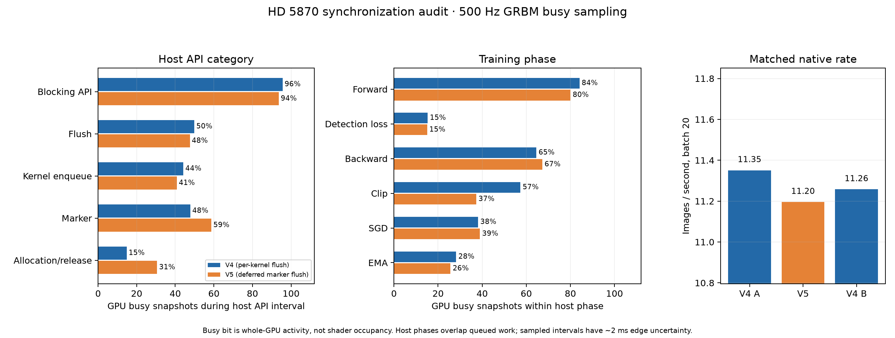

# HD 5870 synchronization and utilization audit, 2026-10-30

## Result

The queue is not obviously starving the GPU while the host waits. In matched
batch-20 training profiles, the GPU busy bit was set in 96% of sampled blocking
API intervals on V4 and 94% on the V5 marker-submit candidate. Whole-profile
activity was 53.4% and 52.8%. The forward phase sampled 84%/80% busy, backward
65%/67%, and detection loss only 15% in both profiles. This points to detection
loss/indexing and host submission as better next profiling targets than
loosening synchronization further.

V5 avoids the immediate `clFlush` for deferred-release markers, batching their
submission with the next already-required per-kernel flush. It retains the
per-kernel flush workaround, completion events and buffer lifetimes; a final
flush still occurs before waiting on outstanding retirement events. The
deferred-lifetime and memory-reporting checks passed, two full-model CPU
loss/gradient comparisons passed, and the batch-one inference suite passed all
800 CPU raw/NMS comparisons.

This reduced marker-related flush calls from 24,212/24,210 to 4 in native
training and from 2,370 to 44 in the diagnostic profile. It did **not** show a
throughput gain: V4 controls measured 11.351 and 11.258 images/s; V5 measured
11.195 images/s (batch 20, 24 measured updates). Since the matched short-run
result is slightly slower, V5 remains an experimental candidate and is not
selected by the HD 5870 training wrapper. V4 stays active.

## What the busy measurements mean

The read-only sampler sampled Radeon `GRBM_STATUS` bit 31 at 500 Hz through the
DRM interface. This indicates whole-GPU activity, not shader/ALU occupancy.
Host API and phase intervals use the same monotonic clock as the sampler, but
include overlap with previously queued GPU work. A busy sample during a blocking
call does not prove that the call itself is productive; it does show that the
queue was generally executing while the host was blocked. Sampled idle-span
edges have about 2 ms uncertainty, and brief bursts can fall between samples.
Device event timestamps were not aligned to the host clock, so this report
makes no kernel-by-kernel causal claims.

The user-visible `radeontop` busy percentage measures a related whole-GPU
activity signal and should not be read as ALU occupancy either. The more useful
correlation here is that blocking calls were almost always accompanied by GPU
activity, while loss/indexing, allocation/release and enqueue intervals had
more idle samples. Synchronization is therefore not the obvious explanation
for the remaining utilization headroom.

## Measurements

| Profile | Whole profile busy | Blocking API busy | Flush busy | Enqueue busy | Forward busy | Loss busy | Backward busy |
| --- | ---: | ---: | ---: | ---: | ---: | ---: | ---: |
| V4, per-kernel flush | 53.4% | 95.7% | 49.9% | 44.2% | 84.1% | 15.3% | 64.6% |
| V5, deferred marker flush | 52.8% | 93.7% | 47.6% | 40.8% | 80.0% | 15.0% | 67.3% |

The training comparison used the same checkpoint, batch 20, 256×256 FP32,
queue limit 128, deferred-release budget 64 MiB and 768 MiB pool reservation.
Profiles included tracing and phase barriers and are diagnostic, not throughput
measurements. Native rates were measured separately without profiling or CPU
checks in the timed window.

The machine-readable measurements, sampler source and raw data are in the
companion experiment record; the summary data is published at
[`benchmarks/hd5870-synchronization-20261030.json`](benchmarks/hd5870-synchronization-20261030.json).
The model and inference script match the existing fixed wildlife benchmark.
V5 inference processed decoded frames at 17.32 FPS mean (68.64 ms P95) and
passed 800 correctness comparisons; it used the existing batch-one queue and
reservation settings, not the training settings.

## Follow-up

Keep the passing per-kernel flush workaround enabled on Cypress. Do not apply
the V5 marker change as a default based on this result. Prioritize the detection
loss/indexing path and host-side operator launch overhead for future profiling.
When the other cards are available, repeat the same fixed model/checkpoint,
CPU-gated training probe and inference suite against the newest source, paying
particular attention to the HD 6970. Keep card-specific Clover workgroup,
allocation and synchronization settings isolated until each card passes its
own correctness gates.
