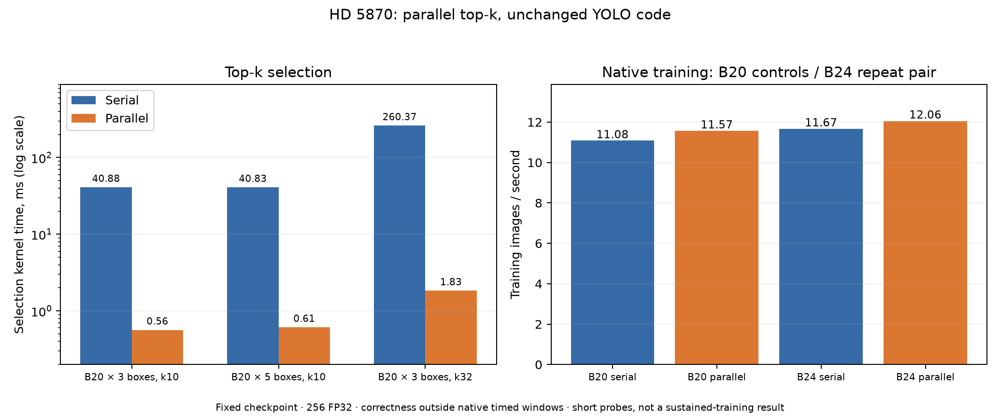

# HD 5870 parallel top-k selection, 2026-10-30

For YOLO target assignment at batch 20 and 256px FP32, the GPU selection kernel
fell from about **41 ms to 0.6 ms**. Matched native training measured
**11.566 images/s**, versus controls of **11.070 and 11.090**: a **4.38%**
gain against their mean. Peak backend storage stayed at **742,998,600 bytes**.
This is a bounded performance result on one Cypress XT 1 GiB with patched
Mesa 25.0.7 Clover/LLVM 15, not evidence of sustained training or every GPU.

The implementation is in the Torch bridge's `src/training_ops.cpp`. No
Ultralytics, DLPrimitives or Mesa code changes are required for this pass.
The rejected deferred-marker-flush experiment from the preceding study is
excluded; the required Cypress per-kernel flush remains enabled.

## Algorithm

The old small-k float selector assigned one work item to each row. For every
winner it rescanned the candidates and checked the previously selected indices.
YOLO's 1,344-candidate rows therefore offered little independent work.

The new path assigns a workgroup of up to 64 work items to each row. Each lane
scans a different part of the row, then a shared-memory reduction chooses the
winner. A value/index total order permits the next scan to skip earlier winners
without searching a selected-index list. Equal values retain lowest-index-first
selection; NaNs sort first for largest and last for smallest. Returning sorted
values when `sorted=False` remains a valid top-k result.

The automatic fast path accepts FP32, a last selection axis of at least 64,
`1 <= k <= 32`, and bounded 32-bit addresses. Workgroup size is a power of two
between 32 and 64, limited by the device's advertised capacities. Other cases
retain serial selection. There is no additional environment flag.

## Correctness fixes found by the regression

The new checks reproduced two bugs in the preceding V4 control:

- Unconditional output resizing replaced the strides of matching-shape output
  views, writing into their gaps. Top-k now resizes only when the output shape
  differs; the noncontiguous values/indices outputs and surrounding guards pass.
- The r600 fallback for larger k and integer inputs could return incorrect
  winners after the first. Its replacement uses 32-bit metadata and explicit
  word pairs for int64 values and indices. A two-dimensional outer/inner launch
  avoids runtime division for row addressing; selection no longer rereads int64
  output indices. Signed int64 comparisons include values beyond FP32/int32's
  exact ranges. The nonlegacy serial implementation is unchanged.

These failures are independent of the new parallel kernel; their original
control reproductions are retained in the experiment record.

## Measurements and validation

| Input and selection | Serial kernel ms | Parallel kernel ms |
| --- | ---: | ---: |
| 20 × 3 × 1,344, k=10 | 40.877 | 0.564 |
| 20 × 5 × 1,344, k=10 | 40.835 | 0.611 |
| 20 × 3 × 1,344, k=32 | 260.373 | 1.832 |

Operator probes use profiling queues; their Torch-call latencies include
allocation, copies and explicit synchronization. Whole-model native speed is
measured separately: six warm updates followed by 24 timed updates, batch 20,
one image worker, two CPU threads, 768 MiB reservation, queue 128 and 64 MiB
deferred-release budget. Timed windows exclude tracing and CPU comparisons.
The control/candidate/control sequence uses the same checkpoint and dataset.

The focused regression passed 129 forward cases: unique/tied values, NaNs,
infinities, smallest/largest, sorted/unsorted requests, offsets, strided inputs
and outputs, empty/scalar cases, larger k, signed wide integers and non-last
axes. It checks real GPU dispatch for both the parallel path and serial path.
The measured operator probes returned bitwise-identical values and indices to
the preceding selector. Two full-model CPU checks passed with loss differences
at most 0.00003052 and gradient cosine above 0.999999999996.

Top-k autograd's numeric check passes, but its separate ATen `scatter.src_out`
backward currently uses an existing CPU fallback. That limitation is recorded
by the test; forward selection has no CPU fallback in the tested cases.
YOLO's task assignment runs without autograd, so it does not use that backward.

The fixed batch-one inference suite also passed 800 CPU raw/NMS comparisons.
The matched V4 control passed another 800. Decoded-frame inference measured
15.66 versus 15.61 FPS; this does not establish an inference speed change.
Training phase profiles are diagnostic: natural loss time fell from 454 to
392 ms, while phase means include overlap and profiling overhead. Use the
separate native rates for the throughput conclusion.

## Batch 24 follow-up

Both snapshots passed two more full-model CPU loss/gradient updates at batch 24,
with maximum loss error 0.00003052. The native probes use a 960 MiB reservation
and the same queue, retirement budget, warmup and timed-update count as above.

| Trial | V4 serial images/s | V8 parallel images/s |
| --- | ---: | ---: |
| First pair | 10.623 | 12.000 |
| Repeated pair | 11.668 | 12.058 |

The first control is unusually slow and its cause is unresolved. All trials
remain in the data; use the repeated pair's **3.34%** change rather than treating
the pooled means as a precise speedup. The updated backend repeatedly reaches
about **12.0 images/s** at batch 24, approximately 4% above its batch-20 result.
Peak backend storage is 885,477,960–885,871,176 bytes (about 845 MiB).
This remains the largest tested batch, not an exact maximum or long-run claim.

Fresh batch-24 GRBM sampling gives about 67–68% whole-GPU busy for both
snapshots in the repeated pair. It does not establish a reduction in jitter
or improved ALU occupancy. Fine sampling for batch 20 was unavailable after a
monitor restart failed on an existing output file; stale samples are excluded.
The independent native timings and host API/GPU-event profiles remain valid.

The selected local training wrapper uses the V8 snapshot, queue limit 128 and
64 MiB retirement budget, and exports the required kernel-flush flag before
the base launcher selects its shim. Reservation remains workload-specific:
768 MiB was tested at batch 20 and 960 MiB at batch 24. Old snapshots remain
available for comparisons. No new model training or checkpoint replacement
was part of these bounded probes.

The [machine-readable record](benchmarks/hd5870-topk-20261030.json) and
standalone figure retain the measurements and limits. Other cards require
their own numeric and timing checks before extending these hardware claims.

